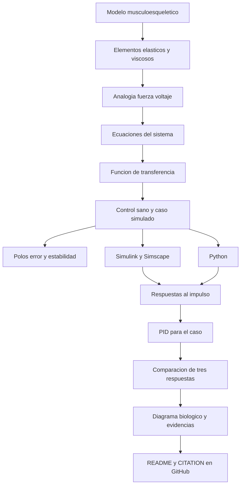

[](https://matlab.mathworks.com/open/github/v1?repo=l23212198-beep/MSFP3)

# Práctica 3 — Modelado y control del sistema musculoesquelético

Repositorio académico de la asignatura **Modelado de Sistemas Fisiológicos**, del programa de **Ingeniería Biomédica** del Tecnológico Nacional de México / Instituto Tecnológico de Tijuana. Esta práctica aplica modelado mecánico, analogía fuerza–voltaje, análisis de sistemas dinámicos y control clásico a un modelo simplificado del sistema musculoesquelético.

Se compara un **individuo sano (control)** con un **caso simulado de atrofia muscular**, representado mediante una variación de la resistencia viscosa equivalente. Se construyen modelos en MATLAB/Simulink, Simscape Electrical y Python, y se estudia cómo un controlador PID puede reducir la diferencia entre sus respuestas durante la experimentación *in silico*.

**Docente:** Dr. Paul Antonio Valle Trujillo  
**Correo:** paul.valle@tectijuana.edu.mx  
**Departamento:** Ingeniería Eléctrica y Electrónica  
**Institución:** Tecnológico Nacional de México / Instituto Tecnológico de Tijuana  
**Asignatura:** Modelado de Sistemas Fisiológicos  
**Programa:** Ingeniería Biomédica  
**Estudiante:** Martin Alonso Gonzalez Holguin · 23212198 · l23212198@tijuana.tecnm.mx

**Repositorio de la asignatura:** https://github.com/DrPaulValle/MSF-IBF1020  
**Sede:** Blvd. Alberto Limón Padilla s/n, Tijuana, C. P. 22454, B. C., México.

---

<a id="contenido"></a>
## Contenido

1. [Resumen](#resumen)
2. [Competencia y objetivos](#objetivos)
3. [Relación con el temario](#temario)
4. [Modelo físico y analogía eléctrica](#analogia)
5. [Formulación matemática](#modelo)
6. [Análisis temporal y de estabilidad](#analisis)
7. [Señales de entrada y condiciones de simulación](#senales)
8. [Implementación en MATLAB, Simulink y Simscape](#matlab)
9. [Control en lazo cerrado y sintonización PID](#pid)
10. [Reproducción en Python](#python)
11. [Alcance de la experimentación](#laboratorio)
12. [Resultados y verificación cruzada](#resultados)
13. [Flujo de trabajo](#flujo)
14. [Actividades del estudiante](#actividades)
15. [Estructura del repositorio](#estructura)
16. [Requisitos](#requisitos)
17. [Reproducibilidad y entregables](#reproducibilidad)
18. [Referencias](#referencias)

---

<a id="resumen"></a>
## Resumen

El sistema musculoesquelético se representa mediante un elemento contráctil que desarrolla una fuerza $F_0(t)$, una fuerza transmitida $F(t)$, un amortiguador viscoso $R$ y dos elementos elásticos de compliancia $C_p$ (paralelo) y $C_s$ (serie). Los desplazamientos $x(t)$ y $x_1(t)$ permiten describir las deformaciones de los componentes. Se utiliza la analogía **fuerza–voltaje** para construir un circuito equivalente y obtener ecuaciones y funciones de transferencia.

La práctica compara dos configuraciones: un individuo sano, denominado **control**, y un **caso simulado de atrofia muscular**, que se diferencia por el aumento de la resistencia equivalente. Se analizan los polos, la estabilidad, el error estacionario y la respuesta al impulso durante $0\le t\le10\,\mathrm{s}$. Posteriormente, se utiliza la salida del control como referencia de un PID aplicado al caso, y se contrastan las simulaciones en MATLAB/Simulink, Simscape Electrical y Python.

**Palabras clave:** sistema musculoesquelético; atrofia muscular simulada; viscoelasticidad; analogía fuerza–voltaje; compliancia mecánica; amortiguamiento viscoso; desplazamiento muscular; respuesta al impulso; control de seguimiento; verificación computacional.

[Volver al contenido](#contenido)

---

<a id="objetivos"></a>
## Competencia y objetivos

### Competencia a desarrollar

Modelar sistemas fisiológicos mediante analogías entre sistemas físicos, ecuaciones diferenciales y funciones de transferencia; analizar su comportamiento dinámico y diseñar estrategias de control clásico. En esta práctica se compara un modelo musculoesquelético sano con uno alterado y se plantea un control exclusivamente computacional.

### Objetivo general

Modelar y analizar un sistema musculoesquelético viscoelástico, comparar la respuesta de las condiciones control y caso, e implementar un controlador PID *in silico* para reducir la diferencia entre ambas respuestas.

### Objetivos específicos

- Identificar los elementos contráctiles, elásticos y viscosos, así como las fuerzas y desplazamientos.
- Construir un circuito equivalente con la analogía fuerza–voltaje.
- Formular ecuaciones mecánicas y eléctricas consistentes y obtener las funciones de transferencia.
- Analizar error estacionario, polos y estabilidad para control y caso.
- Simular ambas condiciones mediante ecuaciones, función de transferencia y Simscape Electrical.
- Comparar sus respuestas ante un impulso unitario en el intervalo de 0 a 10 segundos.
- Sintonizar un PID para acercar la respuesta del caso a la del individuo sano.
- Reproducir y comparar resultados mediante MATLAB y Python.
- Elaborar un diagrama biológico y documentar evidencias en GitHub.

[Volver al contenido](#contenido)

---

<a id="temario"></a>
## Relación con el temario

| Unidad | Área | Contenidos aplicados |
|---|---|---|
| I | Sistemas de control retroalimentados | Polos, estabilidad, error, respuesta temporal y retroalimentación |
| II | Modelado matemático | Elementos viscoelásticos, analogía fuerza–voltaje, ecuaciones diferenciales y función de transferencia |
| III | Controladores | Control PID, sintonización y comparación entre lazo abierto y lazo cerrado |

El trabajo combina mecánica, fisiología muscular, electrónica análoga y simulación computacional.

[Volver al contenido](#contenido)

---

<a id="analogia"></a>
## Modelo físico y analogía eléctrica

El modelo de la **Figura 5.3 del syllabus (p. 87)** contiene una fuente de fuerza contráctil $F_0(t)$, una fuerza transmitida $F(t)$, un elemento viscoso $R$ y dos elementos elásticos: $C_p$ en la rama paralela y $C_s$ en la rama en serie. La deformación del amortiguador se expresa como $x(t)-x_1(t)$, por lo que su velocidad relativa es $\frac{d}{dt}[x(t)-x_1(t)]$.

| Magnitud mecánica | Equivalente eléctrico |
|---|---|
| Fuerza $F(t)$ | Voltaje $V(t)$ |
| Velocidad $\dot x(t)$ | Corriente $I(t)$ |
| Desplazamiento $x(t)$ | Carga $q(t)$ |
| Amortiguador $R$ | Resistor $R$ |
| Compliancia $C_p$, $C_s$ | Capacitores |
| Masa, si está presente | Inductor |

**Importante:** la analogía fuerza–voltaje puede invertir las relaciones de conexión: elementos mecánicos en paralelo pueden corresponder a elementos eléctricos en serie y viceversa. Por ello debe verificarse la referencia mecánica y la topología del circuito, en lugar de copiar visualmente las conexiones.

### Parámetros de simulación

| Parámetro | Control (sano) | Caso (atrofia simulada) |
|---|---:|---:|
| Entrada $F(t)$, representada eléctricamente | 1 V | 1 V |
| Factor $\alpha$ | 0.25 | 0.25 |
| $C_s$ | 10 F | 10 F |
| $C_p$ | 100 F | 100 F |
| $R$ | 100 Ω | 10 kΩ |

Estos son **valores del circuito equivalente para simulación**, no mediciones clínicas. El parámetro modificado entre condiciones es $R$.

[Volver al contenido](#contenido)

---

<a id="modelo"></a>
## Formulación matemática

### Variables y relaciones constitutivas

La fuerza desarrollada por el elemento activo y la fuerza transmitida están relacionadas por

$$F_0(t)=\alpha F(t),\qquad 0<\alpha<1.$$

Para el amortiguador se considera la deformación relativa $x(t)-x_1(t)$ y su derivada temporal. Para cada elemento elástico, la fuerza y el desplazamiento se relacionan mediante su compliancia. Las fuerzas de las ramas deben cumplir el equilibrio mecánico indicado por la topología de la Figura 5.3.

### Desarrollo solicitado

1. Establecer las restricciones de fuerza y desplazamiento a partir del diagrama mecánico.
2. Formular las ecuaciones diferenciales del sistema usando las relaciones de los elementos.
3. Construir las ecuaciones eléctricas correspondientes y verificar la equivalencia dinámica.
4. Aplicar la transformada de Laplace con condiciones iniciales nulas y, si se requiere, superposición.
5. Para una salida de desplazamiento, expresar la función de transferencia como

$$G(s)=\frac{X(s)}{F(s)}.$$

6. Sustituir los parámetros del control y del caso para obtener sus respectivas plantas.

**Nota de alcance:** el syllabus solicita derivar la función de transferencia, pero no proporciona una expresión final única para copiar. La expresión concreta debe proceder de la topología y del desarrollo matemático del estudiante; no se presenta aquí una fórmula no verificada.

[Volver al contenido](#contenido)

---

<a id="analisis"></a>
## Análisis temporal y de estabilidad

### Error en estado estacionario

Determinar la respuesta final de ambos modelos ante una entrada adecuada y calcular el error de seguimiento que corresponda. Comparar cómo el cambio de $R=100\,\Omega$ a $R=10\,\mathrm{k}\Omega$ afecta el comportamiento dinámico, distinguiendo el valor final de los cambios transitorios.

### Polos y estabilidad

Obtener los polos de las funciones de transferencia del control y del caso, ubicarlos en el plano complejo y verificar su estabilidad. Analizar el efecto de la resistencia viscosa equivalente sobre la posición de los polos, el amortiguamiento y la rapidez de respuesta.

### Comparación temporal

Contrastar amplitud, evolución temporal y comportamiento de ambas respuestas antes de introducir el PID. Registrar las conclusiones únicamente después de ejecutar las simulaciones.

[Volver al contenido](#contenido)

---

<a id="senales"></a>
## Señales de entrada y condiciones de simulación

La actividad central de la práctica utiliza una **entrada impulso unitario**, tanto para el control como para el caso, durante el intervalo

$$t\in[0,10]\,\mathrm{s}.$$

Las implementaciones deben utilizar los mismos parámetros, condiciones iniciales y configuración temporal para permitir la comparación. El syllabus no fija un paso numérico universal ni exige las cuatro entradas de la práctica pulmonar; por ello no se trasladan automáticamente sus ajustes.

[Volver al contenido](#contenido)

---

<a id="matlab"></a>
## Implementación en MATLAB, Simulink y Simscape

Para **cada condición** (control y caso) se construyen tres representaciones:

| Implementación | Descripción | Verificación |
|---|---|---|
| Ecuaciones en Simulink | Bloques que implementan el modelo diferencial | Concordancia con el desarrollo mecánico |
| Función de transferencia en Simulink | Planta obtenida con transformada de Laplace | Respuesta entrada–salida |
| Simscape Electrical | Circuito equivalente fuerza–voltaje | Correspondencia con las otras dos representaciones |

Se ejecutan las respuestas al impulso y se comparan los resultados. En un cuaderno MATLAB se deben ejecutar los modelos y recuperar en el *Workspace* las señales del **control**, **caso en lazo abierto** y **caso con PID**. Una función de graficación debe identificar variables y unidades, superponer las respuestas relevantes y exportar figuras en PDF.

[Volver al contenido](#contenido)

---

<a id="pid"></a>
## Control en lazo cerrado y sintonización PID

La respuesta del individuo sano se toma como referencia para el caso simulado de atrofia muscular, según el esquema de la **Figura 5.4 (p. 89)**. La señal de error es

$$e(t)=x_{\mathrm{control}}(t)-x_{\mathrm{caso}}(t).$$

Se incorpora el bloque **PID Controller** de Simulink al modelo del caso y se utiliza **Tune** para determinar las ganancias $k_P$, $k_I$ y $k_D$. El propósito es obtener una respuesta estable que reduzca la diferencia con respecto a la referencia sana.

La forma ideal de la ley PID es

$$u(t)=k_Pe(t)+k_I\int_0^t e(\tau)\,d\tau+k_D\frac{de(t)}{dt}.$$

Después de la sintonización se comparan $x_{\mathrm{control}}(t)$, $x_{\mathrm{caso}}(t)$ y $x_{\mathrm{PID}}(t)$ ante el impulso. Se evalúan amplitud, rapidez, amortiguamiento y error de seguimiento. **No se atribuyen ganancias ni criterios numéricos de desempeño que el syllabus no especifica.**

[Volver al contenido](#contenido)

---

<a id="python"></a>
## Reproducción en Python

En **Visual Studio Code** se implementan las funciones de transferencia del control y del caso. Se calculan sus respuestas al impulso bajo las mismas condiciones utilizadas en MATLAB/Simulink y se incorporan las ganancias PID obtenidas con **Tune** para representar el caso controlado.

El código debe generar y guardar las figuras que permitan contrastar las tres respuestas y comprobar la consistencia entre plataformas. Las bibliotecas concretas se determinan a partir de los `import` del script utilizado; el syllabus no establece una lista obligatoria.

[Volver al contenido](#contenido)

---

<a id="laboratorio"></a>
## Alcance de la experimentación

Esta práctica se realiza **exclusivamente *in silico***. El circuito equivalente se construye en **Simscape Electrical** y no se requiere montar una planta física, un controlador analógico en protoboard ni efectuar mediciones con osciloscopio.

La comparación entre control y caso es una **representación académica simplificada**: el cambio de resistencia equivalente no debe interpretarse como una descripción clínica completa de la atrofia muscular. El controlador diseñado no constituye un tratamiento médico.

[Volver al contenido](#contenido)

---

<a id="resultados"></a>
## Resultados y verificación cruzada

Se deben contrastar las respuestas del **individuo sano**, del **caso en lazo abierto** y del **caso con PID**.

| Evidencia | Control | Caso | Caso con PID |
|---|---|---|---|
| Ecuaciones en Simulink | Respuesta al impulso | Respuesta al impulso | Según integración del controlador |
| Función de transferencia | Respuesta al impulso | Respuesta al impulso | Respuesta controlada |
| Simscape Electrical | Circuito equivalente | Circuito equivalente | Si se implementa su conexión controlada |
| Cuaderno MATLAB | Figura comparativa | Figura comparativa | Figura comparativa |
| Python | Figura comparativa | Figura comparativa | Figura comparativa |

### Discusión de resultados

- Explicar el efecto del incremento de $R$ sobre la respuesta dinámica.
- Verificar coincidencias y diferencias entre ecuaciones, función de transferencia y circuito equivalente.
- Analizar si el PID aproxima la salida del caso a la del control.
- Comparar las gráficas de MATLAB y Python, identificando diferencias numéricas o de implementación.
- Relacionar las observaciones con el comportamiento viscoelástico del modelo y sus limitaciones.

**Pendiente de completar con evidencias reales:** polos calculados, ganancias PID, figuras obtenidas, interpretación de resultados y conclusiones. No se incluyen resultados ficticios.

[Volver al contenido](#contenido)

---

<a id="flujo"></a>
## Flujo de trabajo



La secuencia conecta el modelo físico, la simulación y el análisis del controlador sin atribuir al trabajo un experimento clínico.

[Volver al contenido](#contenido)

---

<a id="actividades"></a>
## Actividades del estudiante

### Etapa 1. Modelo y análisis

- [ ] Identificar $F_0(t)$, $F(t)$, $R$, $C_p$, $C_s$, $x(t)$ y $x_1(t)$.
- [ ] Construir la analogía fuerza–voltaje respetando la topología.
- [ ] Formular las ecuaciones y derivar las funciones de transferencia.
- [ ] Calcular error estacionario, polos y estabilidad de ambas condiciones.

### Etapa 2. Simulación

- [ ] Implementar ecuaciones y funciones de transferencia en Simulink.
- [ ] Implementar los circuitos equivalentes en Simscape Electrical.
- [ ] Comparar las respuestas al impulso de control y caso de 0 a 10 s.

### Etapa 3. Control y comprobación

- [ ] Implementar el PID en el caso y sintonizar $k_P$, $k_I$, $k_D$.
- [ ] Comparar control, caso y caso controlado.
- [ ] Ejecutar el cuaderno MATLAB y exportar las figuras.
- [ ] Reproducir los resultados en Python y efectuar verificación cruzada.

### Etapa 4. Documentación

- [ ] Elaborar el diagrama biológico con elemento contráctil, estructuras elásticas, tendón, fuerza, desplazamiento y componente viscosa.
- [ ] Integrar ecuaciones, gráficas, capturas y discusión.
- [ ] Publicar `README.md`, `CITATION.cff` y los archivos realmente utilizados.

[Volver al contenido](#contenido)

---

<a id="estructura"></a>
## Estructura del repositorio

Organización **sugerida**, que debe adaptarse a los nombres de los archivos reales:

```text
.
├── README.md                         # Documentación de la práctica
├── CITATION.cff                      # Datos de citación
├── Apellido_NoControl.mlx            # Cuaderno MATLAB
├── Apellido_NoControl.pdf            # Exportación del cuaderno
├── musculoesqueletico.slx            # Modelos Simulink/Simscape
├── musculoesqueletico.py             # Script de Python
├── diagrama_biologico.png            # Relación biológica y mecánica
├── figuras/
│   ├── impulso_matlab.pdf            # Comparación MATLAB
│   └── impulso_python.pdf            # Comparación Python
└── evidencias/                       # Capturas y resultados
```

**Los nombres son propuestas**, no nombres de archivos confirmados en el syllabus. Actualizar las rutas y eliminar entradas que no existan antes de publicar el repositorio.

[Volver al contenido](#contenido)

---

<a id="requisitos"></a>
## Requisitos

### Software

- **MATLAB** y **Simulink** para el modelo, la función de transferencia y el controlador.
- **Simscape Electrical** para el circuito equivalente.
- Herramienta **Tune** del bloque `PID Controller`.
- **Python** y **Visual Studio Code** para reproducir las simulaciones.
- **BioRender** o una herramienta equivalente para el diagrama biológico.
- **Git y GitHub** para la entrega y documentación.

No se especifican versiones mínimas en el apartado 5.5. Tampoco se requieren instrumentos físicos de laboratorio para esta práctica.

[Volver al contenido](#contenido)

---

<a id="reproducibilidad"></a>
## Reproducibilidad y entregables

### Secuencia de reproducción

1. Consultar el apartado 5.5 del syllabus, páginas 87–95.
2. Identificar los elementos de la Figura 5.3 y formular la analogía fuerza–voltaje.
3. Derivar ecuaciones y funciones de transferencia para ambas condiciones.
4. Analizar polos, estabilidad y error estacionario.
5. Ejecutar las representaciones de Simulink y Simscape con impulso unitario de 0 a 10 s.
6. Sintonizar el PID del caso tomando como referencia la respuesta sana.
7. Ejecutar el cuaderno MATLAB y exportar las figuras.
8. Reproducir las respuestas en Python con las ganancias sintonizadas.
9. Elaborar el diagrama biológico y realizar la verificación cruzada.
10. Integrar resultados, discusión, conclusiones y archivos en GitHub.

| Entregable | Contenido |
|---|---|
| Modelo mecánico | Identificación de elementos, fuerzas y desplazamientos |
| Analogía | Circuito eléctrico equivalente y explicación de conexiones |
| Matemáticas | Ecuaciones, funciones de transferencia, polos y error |
| Simulaciones | Archivos Simulink y Simscape para control y caso |
| Control | PID, ganancias y comparación de tres respuestas |
| MATLAB y Python | Códigos, figuras y verificación cruzada |
| Diagrama biológico | Elemento contráctil, tendón, elasticidad, viscosidad y desplazamiento |
| Documentación | `README.md`, `CITATION.cff`, capturas, discusión y conclusiones |

### Criterios de presentación académica

Distinguir claramente el modelo de referencia, las simulaciones efectivamente ejecutadas y las modificaciones propias. No presentar los parámetros del caso como mediciones de un paciente real ni el PID como intervención terapéutica.

[Volver al contenido](#contenido)

---

<a id="referencias"></a>
## Referencias

[1] M. C. Khoo, *Physiological Control Systems: Analysis, Simulation, and Estimation*, 2nd ed., IEEE Press, 2018.

[2] F. C. Hoppensteadt y C. S. Peskin, *Modeling and Simulation in Medicine and the Life Sciences*, Springer.

[3] J. E. Hall, *Guyton and Hall Textbook of Medical Physiology*, 14th ed., Elsevier, 2021.

[4] K. Ogata, *Ingeniería de Control Moderna*, 5.ª ed., Pearson Educación, 2010.

[5] N. S. Nise, *Control Systems Engineering*, 8th ed., John Wiley & Sons, 2020.

[6] P. A. Valle, *Syllabus para Modelado de Sistemas Fisiológicos*, Tecnológico Nacional de México / Instituto Tecnológico de Tijuana, 2026, apartado 5.5, pp. 87–95. https://biomath.xyz/course/

[7] Tecnológico Nacional de México, *Programa de estudio de la asignatura Modelado de Sistemas Fisiológicos, IBF-1020*.

[Volver al contenido](#contenido)

---

## Uso académico

Este repositorio documenta la práctica 5.5 de **Modelado y control del sistema musculoesquelético**. Los resultados corresponden a simulaciones académicas *in silico*; no representan un diagnóstico ni una propuesta de tratamiento clínico.
